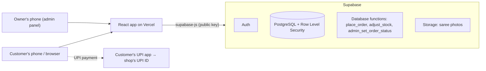

# SareeSetu — E-commerce & Inventory Platform for Vaibhav Laxmi Saree

An online store and admin panel built for a real saree shop: **Vaibhav Laxmi Saree**, Kamothe, Navi Mumbai (since 2016) — *“A Saree for Every Occasion”*.

Customers browse the shop's real catalogue, choose a colour, add fall beading / pico, and pay by **UPI**. The owner manages sarees, photos, online stock and orders from her phone, and keeps a **private record of in-shop stock** that customers never see.

> Final-year B.E. Information Technology major project — SIES Graduate School of Technology, University of Mumbai (2026–27). An outhouse project developed for a real client.

## Team

| Member | Role |
|---|---|
| Yuvrajvarthan Nadar | Backend, database, security, deployment (lead) |
| Akash Konar | Frontend and UI |
| Sneha Thevar | UI and documentation |

---

## Features

### For customers
- **Real catalogue** of sarees with colour variants: one page per design, colour swatches that switch the photos
- Filters by category, occasion, fabric, colour and price; search and sort
- Wishlist and bag (saved on the device)
- Sign up / log in with email (Google login ready to switch on)
- **Checkout**: delivery address (saved for next time), delivery charge by pincode, optional **fall beading ₹70 / pico ₹30**
- **UPI payment** with a QR code and a “Pay with UPI app” button, then the customer enters the 12-digit UTR
- **My Orders** with a progress bar: Placed → Paid → Packed → Shipped (with tracking no.) → Delivered

### For the owner (admin panel at `/admin`)
- **Dashboard**: payments to check, orders to pack / ship, returns, today's orders, this month's sales, stock alerts
- **Sarees**: add a new saree with photos (shrunk in the browser before upload), colours and stock; save as a hidden draft, then publish; hide / show in one tap
- **Pricing rule built in**: she enters her own price, the website price is calculated automatically (and can be overridden)
- **Online stock** per colour with a full **stock register** (who changed what, when and why)
- **Orders**: verify or reject UPI payments, mark packed, shipped (courier + tracking no.) and delivered, record returns / exchanges, cancel (stock is returned), ready-made WhatsApp messages to the customer
- **Two separate inventories**: online stock for the website, and a private in-shop stock record (in progress)

### Security
- **Row Level Security on every table** — customers can only see their own orders, addresses and profile
- The owner's base prices and in-shop stock are **admin-only, even for reading**
- Prices, totals, delivery charges and stock changes are calculated **inside the database**, never trusted from the browser
- Admin rights can only be given by hand in the database; every admin action is written to an **activity log**
- Photo uploads: JPG / PNG / WebP only, max 5 MB, admins only
- An automated check (`npm run check:security`) tests the live rules as a visitor and as a customer

---

## Tech stack

| Layer | Technology |
|---|---|
| Frontend | React 19, Vite, Tailwind CSS, React Router |
| Backend | Supabase — PostgreSQL, Auth, Storage, Row Level Security |
| Business logic | PostgreSQL functions (place order, stock changes, order status) |
| Validation | Zod (browser) + database constraints and checks |
| Hosting | Vercel (frontend) + Supabase (free tier) |



There is no separate application server: the browser talks to Supabase directly, and the database itself decides what each user may read or change.

---

## Project structure

```
client/                 React website + admin panel
  src/pages/            customer pages (Home, Collection, Product, Cart, Checkout, Orders, Account…)
  src/pages/admin/      admin pages (Dashboard, Sarees, Add/Edit Saree, Orders, Stock Register…)
  src/lib/              data access (catalogue, orders, admin), validation
  scripts/check-security.mjs   live security test
supabase/migrations/    database tables, security rules and functions — run in number order
supabase/snippets/      hand-run SQL (e.g. make a user an admin)
scripts/                one-time catalogue upload script (uses a secret key kept off Git)
catalogue/CATALOGUE.md  how the real catalogue was prepared (the catalogue itself is private)
docs/brand/             logo and brand kit
server/                 early Express prototype — no longer used, to be removed
```

---

## Running it locally

**Requirements:** Node.js 20+ and a Supabase project.

1. **Database** — in Supabase → SQL Editor, run every file in `supabase/migrations/` **in number order** (001 → 010).
2. **Website**
   ```bash
   cd client
   cp .env.example .env.local      # fill in VITE_SUPABASE_URL and VITE_SUPABASE_ANON_KEY (publishable key)
   npm install
   npm run dev                     # http://localhost:3000
   ```
3. **Admin account** — create a user in Supabase → Authentication → Users, then run `supabase/snippets/make_admin.sql` with that email. Log in at `/admin/login`.
4. **Catalogue (optional)** — the real catalogue and the owner's prices are private and not in this repository. With the `catalogue/` folder present, `cd scripts && npm install && npm run seed` uploads it (needs `scripts/.env`, see `scripts/.env.example`). Without it, add sarees from the admin panel.
5. **Security check** — `cd client && npm run check:security` (add a test customer to `.env.local` for the logged-in checks).

> Never put the Supabase **secret / service_role** key in `client/` or in Git. The public (anon / publishable) key is safe in the browser because every table is protected by Row Level Security.

---

## Progress (Semester VII)

- [x] Real shop content, logo and branding
- [x] Supabase database, security rules, storage and the real catalogue
- [x] Shop pages read the live catalogue
- [x] Customer and admin login, protected admin area
- [x] Admin: sarees, photos, pricing rule, online stock, stock register
- [x] Checkout with delivery charges, add-ons and UPI payment
- [x] Admin orders: payment verification, packing, shipping, returns
- [ ] Order on WhatsApp button, About, Services, Policies, 404
- [ ] Private in-shop inventory
- [ ] Settings, categories, activity log, CSV backup
- [ ] Deployment and mobile testing

## Future scope (Semester VIII)
- Cash on Delivery and courier integration (after the shop signs a delivery partner)
- Hindi and Marathi interface
- Smart features: tagging a saree from its photo, search by photo, recommendations, demand insights from real orders

---

## Client and data

Shop details, logo and product photos belong to **Vaibhav Laxmi Saree** (Prop. Mrs. Mamta Bhandari) and were provided by the shop for this project. The owner's private prices and supplier messages are deliberately kept out of this public repository.

*Academic project — not licensed for reuse.*
