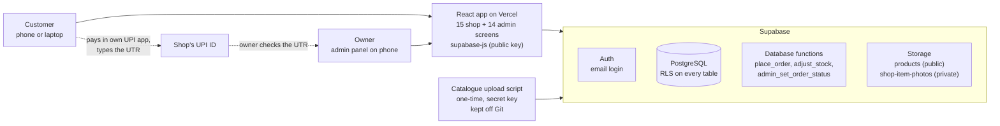
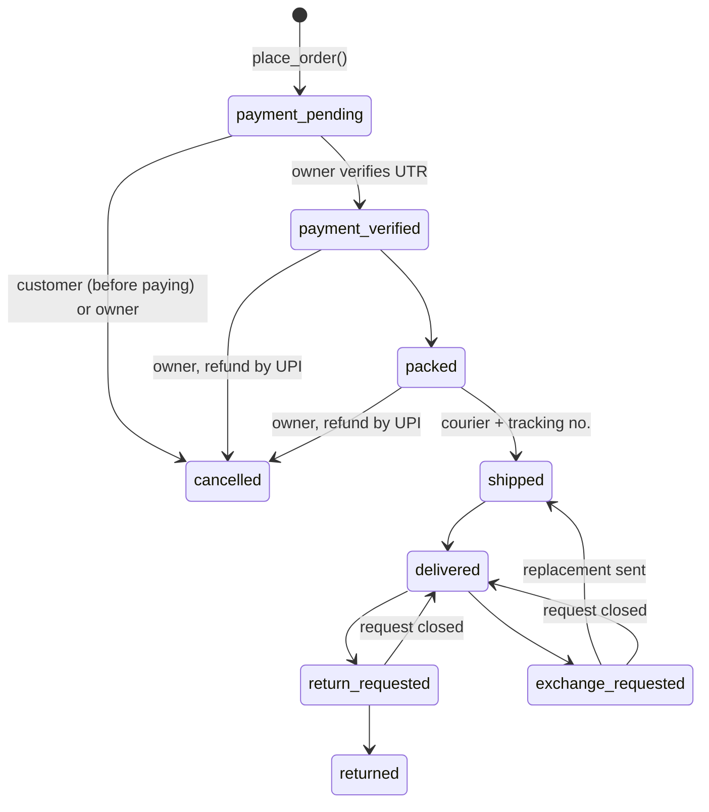
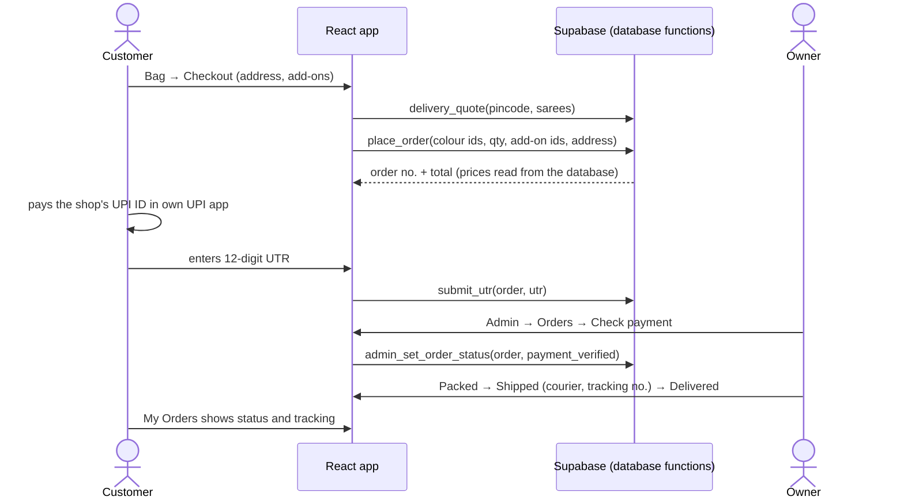
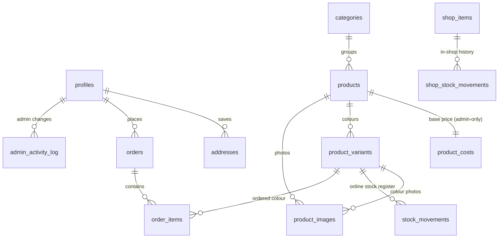

# Project overview — SareeSetu

How the Vaibhav Laxmi Saree website and admin panel are built, for the team, our guide and examiners. For setup steps see the [main README](../README.md).

**Status (12 Oct 2026):** build steps 1–9 are done and tested on the live database; step 10 (deployment, phone testing, demo rehearsal) is next.

---

## 1. Architecture

There is no server of our own. The React app talks to Supabase directly with the public key, and Supabase's rules (Row Level Security and database functions) decide what each person may read or change.

| Layer | Tools |
|---|---|
| Frontend | React 19, Vite 8, Tailwind CSS 3, React Router 7, zod (forms), qrcode (UPI QR) |
| Backend | Supabase: PostgreSQL, Row Level Security, database functions (RPC), Auth, Storage |
| Tooling | Node scripts (catalogue upload, live security check), PGlite (local SQL tests), oxlint |
| Hosting | Vercel (frontend), Supabase free tier |

---

## 2. Features

### Customer website (15 pages)

| Page | What it does |
|---|---|
| Home | Hero, 9 category tiles with real counts, featured sarees (never sold-out ones) |
| Collection / Category | Filters (category, occasion, fabric, colour, price), search, sort, 24 per page, sold-out last |
| Saree detail | Photos per colour, swatches, stock badge, fall / pico prices, Add to Bag, wishlist, **Order on WhatsApp** |
| Bag, Wishlist | Saved on the device; max 10 per colour |
| Login / Sign up / Reset | Email + password with show / hide; Google login built, switched off for now |
| Checkout | Saved or new address, delivery charge from pincode, fall beading ₹70 / pico ₹30 per saree, UPI |
| Order page | Progress bar, UPI QR + pay button, UTR entry, cancel before paying, courier + tracking |
| My Account | Profile, My Orders, saved addresses |
| About & Contact, Services, Policies, Store Locator, 404 | Shop story and contact; tailoring price list; shipping, payment, returns, cancellation, privacy, terms; map; not-found page |

### Admin panel (14 screens, `/admin`)

| Screen | What the owner does |
|---|---|
| Dashboard | Payments to check, orders to pack / ship, returns, shop items low, today's orders, month's paid sales, stock alerts |
| Sarees, Add / Edit Saree | Live / Hidden / Out-of-stock tabs, hide / show, per-colour stock; new saree as draft → publish, photos shrunk in the browser, website price from her base price |
| Online Stock Register | Every online stock change with who, when, why |
| Orders, Order view | Verify / reject payment, packed, shipped (courier + tracking no.), delivered, returns, exchanges, cancel, WhatsApp message templates |
| Customers, Categories | Customer list with orders and amount paid; add / rename / hide categories |
| Shop Items, Item form, Shop Stock History | Private in-shop inventory: received / sold / returned / damaged / correct count, low-stock list, history |
| Shop Settings | UPI ID, delivery charges, tailoring prices, 7 CSV backups |
| Activity Log | Every admin change, read-only |
| Admin Login | Separate login; non-admins see "Not authorised" |

---

## 3. Order flow

**Business rules**

- Website price = owner's base price + ₹300 (below ₹1,100) or + ₹500 (₹1,100 and above); can be set by hand. The base price is admin-only.
- Each colour has its own online stock. Empty = not tracked yet (orderable; availability confirmed before dispatch). 0 = out of stock.
- Online stock and in-shop stock are two separate inventories and are never linked.
- Placing an order reserves tracked stock; cancelling returns it; stock never goes below 0.
- Delivery by pincode: Mumbai & Navi Mumbai ₹60, rest of Maharashtra ₹80, rest of India ₹120, + ₹30 per extra saree.
- UPI only for now; one UTR per order; at most 3 unpaid orders per account per day.
- Returns: within 48 hours of delivery (unboxing video), return / exchange within 7 days, UPI refund within 7 working days; not for stitched blouses, sarees with fall / pico, sale items.
- Sarees are hidden, never deleted, so order history stays correct.

---

## 4. Database

Plus `services` (tailoring price list; fall beading and pico are online add-ons) and `settings` (one row: UPI ID, payee name, delivery zones, extra-saree charge, shop info).

Migrations in `supabase/migrations/`, run in order:

| File | Adds |
|---|---|
| 001_schema | Tables |
| 002_security | Permissions, RLS on every table, `is_admin()` |
| 003_functions | Stock function, activity-log triggers |
| 004_storage | First photo bucket |
| 005_seed | First sample data (replaced in 008) and settings |
| 006_lock_trigger_functions | Closes a gap flagged by the Supabase Security Advisor |
| 007_two_inventories | Private shop inventory, UPI-only payment method |
| 008_catalogue_variants | Colours, private base price + price rule, services, real categories |
| 009_orders | Delivery quote, place order, UTR, customer cancel |
| 010_admin_orders | Owner's order actions |

---

## 5. Security

| Requirement | How it is enforced |
|---|---|
| RLS on every table | All 15 tables; permissions start from nothing and grant only named columns |
| Admin check | `is_admin()` (profiles.role = 'admin') in every rule and inside every admin function |
| No public way to become admin | Sign-up always creates a customer; `role` is not writable; admins are made by hand with SQL |
| Prices and totals | Calculated only inside `place_order()`; the browser sends ids and quantities, never prices |
| Private data | Base prices, shop inventory, stock register and activity log are admin-only even for reading |
| Uploads | JPG / PNG / WebP, shrunk in the browser, ≤ 5 MB, admin-only; shop photos in a private bucket |
| Audit | Every admin change is written to `admin_activity_log`, which cannot be edited or deleted |
| Secrets | Only the public key is in the frontend; the secret key stays in a git-ignored file; the real catalogue and base prices are not in this repo |
| Backups | 7 CSV exports from Shop Settings |

---

## 6. Testing

| Test | Result |
|---|---|
| Live security check — visitor and customer try 61 allowed / forbidden actions (`npm run check:security`) | 61 / 61 |
| Local database tests (PGlite) — checkout | 40 / 40 |
| Local database tests — admin order actions | 28 / 28 |
| Live end-to-end — order placed, paid, verified, packed, shipped, delivered | 14 / 14 |
| Live — private shop inventory, including privacy of photos | 21 / 21 |
| Live — admin saree add / publish / hide / stock | 16 / 16 |
| Build and lint after every change; screenshots at desktop and phone width | Clean |

---

## 7. What's next

- **Step 10:** deploy to Vercel, add the live URL to Supabase Auth settings, test on phones (including a real UPI payment), rehearse the demo.
- **After the demo:** Google login, own email sending, hand accounts over to the shop email, editable shop phone / hours, remove the unused `server/` prototype.
- **Semester VIII:** Cash on Delivery and courier integration, Hindi / Marathi interface, photo-based tagging and search, recommendations, demand insights.
